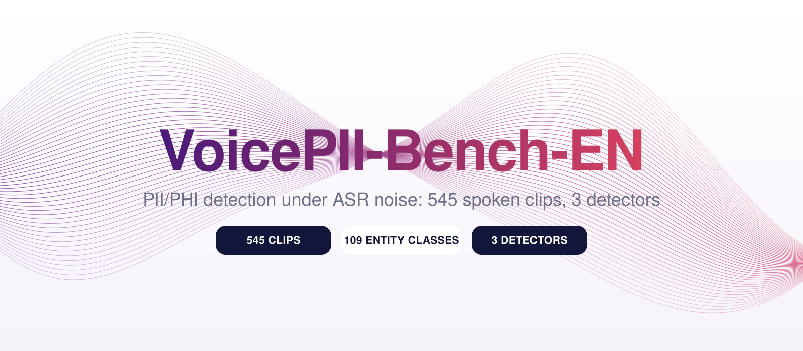
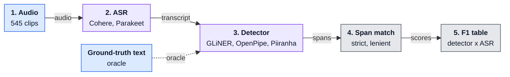

<div align="center">
  

  <p>
    <a href="LICENSE"></a>
    <a href="#license"></a>
    <a href="pii_phi_voice_benchmark_dataset.csv"></a>
    <a href="#dataset"></a>
    <a href="#setup"></a>
  </p>

  <h3>What happens to PII/PHI detection when the text comes from speech?</h3>

  <p>
    A synthetic spoken-PII benchmark and reproducible harness that measures how ASR
    errors propagate into three open-source PII/PHI detectors, from oracle text
    all the way to noisy transcripts.
  </p>

  <p>
    <a href="#whats-included"><b>What's included</b></a> ·
    <a href="#how-it-works"><b>How it works</b></a> ·
    <a href="#setup"><b>Setup</b></a> ·
    <a href="#reproducing-the-papers-results-table"><b>Reproduce</b></a> ·
    <a href="#scoring-methodology"><b>Scoring</b></a> ·
    <a href="#dataset"><b>Dataset</b></a>
  </p>
</div>

> **Anonymous review copy.** This repository has been anonymized for double-blind
> review. The full dataset (audio + ground-truth labels), a persistent citation,
> and any author-identifying information will be added upon acceptance.

## Overview

Voice agents, call-center analytics and meeting tools all run PII/PHI detection on
**ASR transcripts**, not on clean text. VoicePII-Bench-EN isolates that gap. Each of
the 545 clips contains exactly one sensitive value, so every detection is traceable
to a known character span.

| | |
| --- | --- |
| **545** clips | 21-35 words, about 8-14 seconds each |
| **109** entity classes | across 10 categories |
| **3** detectors | GLiNER, OpenPipe, Piiranha |
| **2** ASR systems | Cohere Transcribe (3.55% WER), Parakeet TDT (32.14% WER) |
| **3** conditions | ground truth (oracle), Cohere transcript, Parakeet transcript |

Example clip (`pii_phi_voice_benchmark_dataset.csv`):

> *"Hi, thanks for picking up. My license number is* **RN-448291**, *could you confirm that's correct?..."*
> entity class: `Professional License Number`

## How it works



Blue steps are data, purple steps run models, grey steps are scoring code. The dashed path is the oracle condition, which skips ASR.

1. **Transcribe** each clip with an ASR system (`asr.py`).
2. **Detect** PII/PHI spans in the transcript with a detector (`detectors.py`).
3. **Align** predicted spans back to the original text's character offsets by word-level sequence alignment (`scoring.py`).
4. **Score** against ground truth with four span-matching metrics, then assemble the results table (`build_table.py`).

The oracle condition skips step 1 and runs the detector directly on the ground-truth script, which gives the ceiling each detector can reach.

## What's Included

| Component | Description |
|---|---|
| `pii_phi_voice_benchmark_dataset.csv` | 545 ground-truth clips: script text, entity class, target PII/PHI value, and character-offset span |
| `audio_en/` | Corresponding synthesized audio for each clip (`<script_id>.mp3`) |
| `detectors.py` | Entity maps and detection functions for the 3 evaluated detectors |
| `asr.py` | Transcription functions for the 2 evaluated ASR systems |
| `scoring.py` | Span-matching scoring logic (strict / trimmed-strict / compound-strict / lenient) |
| `run_ground_truth_benchmark.py` | Scores a detector directly against ground-truth text (the oracle condition) |
| `run_asr_benchmark.py` | Transcribes audio with a chosen ASR system, then scores a detector against the resulting transcript |
| `build_table.py` | Assembles the paper's main results table from all scored conditions |
| `voices.py` | Maps each of the dataset's 12 (accent, gender) voice slots to the open-source TTS engine and voice used to synthesize it |
| `fetch_reference_clips.py` | Sources the Chatterbox voice-cloning reference clips from Mozilla Common Voice accent-filtered subsets |
| `generate_audio_en.py` | Regenerates `audio_en/` from `pii_phi_voice_benchmark_dataset.csv` using the voice map in `voices.py` |
| `relabel_voice_metadata.py` | One-time rewrite of the CSV's voice metadata columns to match the open-source regeneration pipeline |

This repository is intentionally scoped to only what is reported in the
paper: three detector architectures (GLiNER, OpenPipe, Piiranha) and two
ASR systems (Cohere Transcribe, Parakeet TDT), evaluated on the English-language
portion of a larger benchmark we constructed. A broader multilingual extension
exists but is outside the scope of this paper (see Limitations in the paper).

## Detectors and ASR Systems Evaluated

**Detectors** (different architectural approaches to PII/PHI detection):

| Detector | Model | Approach |
|---|---|---|
| **GLiNER** | `nvidia/gliner-PII` | Zero-shot NER, targets arbitrary entity labels at inference time |
| **OpenPipe** | `PII-Redact-General` | Generative model, tags entities inline in rewritten text |
| **Piiranha** | `iiiorg/piiranha-v1-detect-personal-information` | Fixed-taxonomy token classifier |

**ASR systems** (selected for a substantial accuracy gap on our audio):

| ASR | Model | WER |
|---|---|---|
| **Cohere Transcribe** | `CohereLabs/cohere-transcribe-03-2026` | 3.55% |
| **Parakeet TDT** | `nvidia/parakeet-tdt-0.6b-v3` | 32.14% |

## Setup

We recommend a virtual environment rather than installing into your
system Python; on Debian/Ubuntu-based systems in particular, a bare `pip
install` outside a virtual environment will typically fail outright with
an `externally-managed-environment` error.

```bash
python3 -m venv venv
source venv/bin/activate   # on Windows: venv\Scripts\activate

pip install torch transformers>=5.4.0 gliner pii-redaction
pip install librosa
pip install accelerate

# Cohere Transcribe is a gated model -- accept its license on the model
# page, then authenticate:
huggingface-cli login
```

Each new terminal session requires re-running `source venv/bin/activate`
before using any script in this repository -- if a command fails with a
`ModuleNotFoundError` for a package you already installed, this is the
most common cause.

GPU acceleration (CUDA or Apple Silicon MPS) is auto-detected and strongly
recommended; all three detectors and both ASR systems fall back to CPU
but will be substantially slower.

## Reproducing the Paper's Results Table

```bash
# Ground-truth (oracle) condition
python3 run_ground_truth_benchmark.py --detector gliner
python3 run_ground_truth_benchmark.py --detector openpipe
python3 run_ground_truth_benchmark.py --detector piiranha

# Cohere Transcribe condition
python3 run_asr_benchmark.py --asr cohere --detector gliner
python3 run_asr_benchmark.py --asr cohere --detector openpipe
python3 run_asr_benchmark.py --asr cohere --detector piiranha

# Parakeet TDT condition
python3 run_asr_benchmark.py --asr parakeet --detector gliner
python3 run_asr_benchmark.py --asr parakeet --detector openpipe
python3 run_asr_benchmark.py --asr parakeet --detector piiranha

# Assemble the final table
python3 build_table.py
```

Each script is independently resumable: cached transcripts
(`transcripts_<asr>/`) and cached detector outputs
(`ground_truth_raw_<detector>/`) are skipped on re-run, so an interrupted
run can simply be restarted. Add `--limit N` to any command to smoke-test
on a small subset before committing to the full 545-clip run.

## Scoring Methodology

We report four span-matching metrics for every prediction:

- **Strict**: exact character-offset match.
- **Trimmed-strict**: exact match after stripping leading/trailing
  whitespace or punctuation a detector's own offset computation
  sometimes includes. Reported separately from raw strict for
  transparency; for Piiranha specifically, this correction is necessary
  because a confirmed tokenizer artifact otherwise affects nearly every
  predicted span (raw strict F1 of 0.0 vs. trimmed-strict F1 in line with
  lenient F1). No analogous gap was observed for GLiNER or OpenPipe.
- **Compound-strict**: credits a detector for correctly decomposing one
  ground-truth entity into two or more adjacent predicted spans (e.g. a
  full name split into separate given-name and surname spans). This
  credit is only applied when at least two spans are genuinely being
  merged; a single span must still match an expected type for the gold
  entity, which prevents a lone, wrongly-typed detection from receiving
  undeserved credit (see full discussion in the paper).
- **Lenient**: any character overlap between predicted and gold spans.

All metrics are computed only over each detector's own supported entity
subset (i.e., entity types it was designed or mapped to detect), so a
detector is never penalized for entity types outside its scope.

For the two ASR conditions, a detector's predicted spans are computed on
the ASR transcript, then mapped back to the original ground-truth text's
character coordinates via word-level sequence alignment
(`scoring.py`). Clips where the transcript has diverged too far
from the original text to trust this mapping (aligned word overlap below
30%) are excluded from scoring for that condition and reported as
alignment failures in each script's console output.

## Dataset

545 short synthetic spoken utterances (21-35 words, ~8-14 seconds each),
each containing exactly one PII/PHI value from a taxonomy of 109 entity
classes across 10 categories. Script text was LLM-generated and
subsequently reviewed and corrected by human annotators; audio is
synthesized via text-to-speech across a 12-voice pool stratified across 8
accent categories and both genders.

Audio is generated entirely with open-source TTS engines -- Kokoro-82M
(Apache 2.0) and Chatterbox (MIT) -- rather than a closed API, so that the
dataset itself can be freely redistributed under this repository's own
license. See `voices.py` for the per-voice-slot engine mapping and
`generate_audio_en.py` to regenerate `audio_en/` from the ground-truth
CSV.

**All PII/PHI values in this dataset are synthetically generated and do
not correspond to any real individual.**

## License

- **Code** (all `.py` files in this repository): MIT License.
- **Dataset** (`pii_phi_voice_benchmark_dataset.csv` and `audio_en/`): CC-BY-4.0.

This license applies only to the code and dataset contained in this
repository. It does **not** extend to the third-party models this code
downloads and calls at runtime (GLiNER, OpenPipe, Piiranha, Cohere
Transcribe, Parakeet TDT), each of which is subject to its own separate
license and terms of use set by its respective publisher. Notably,
Piiranha is distributed under CC-BY-NC-ND-4.0 (noncommercial, no
derivatives) and Cohere Transcribe is a gated model requiring separate
license acceptance -- users of this repository are responsible for
independently reviewing and complying with each model's own terms before
use.

## Citation

A citation will be provided here upon acceptance.

